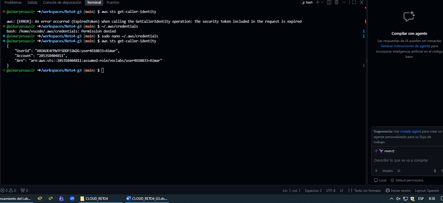
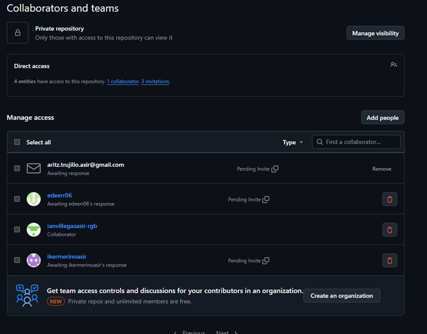

# Informe técnico — CLOUD Reto 4

> **Estado del documento:** guía de procedimiento. Sustituir los campos
> `[PENDIENTE]` por datos y capturas reales antes de entregar. No presentar
> comandos previstos como pruebas ya realizadas.

## 1. Objetivo y arquitectura

Desplegar la web F1 Bilbao en AWS us-east-1 con Terraform y cuatro instancias
Ubuntu: un manager y tres workers Docker Swarm. La imagen se publica en Docker
Hub y el servicio usa cuatro réplicas con publicación HTTP por el puerto 80.
Véase el [diagrama de arquitectura](diagramas/arquitectura.md).

## 2. Fase 0 — Entorno colaborativo

El Codespace se define en `.devcontainer/devcontainer.json` e incorpora AWS CLI
y Terraform. El repositorio es el punto común de trabajo; el grupo debe aportar
evidencias de su privacidad, colaboradores, PRs y Codespace.

**Comprobaciones**

```bash
aws --version
terraform version
git status --short --branch
```

**Evidencias por añadir**

- [PENDIENTE] Captura del Codespace creado y con AWS CLI/Terraform disponibles.
- [PENDIENTE] Captura de Settings mostrando repositorio privado y colaboradores,
  sin exponer información que no deba publicarse.
- [PENDIENTE] Historial de commits y PRs de los integrantes.

## 3. Fase 1 — Infraestructura con Terraform

`terraform/main.tf` define un manager y workers con `count`; tamaños, región,
AMI, grupo y discos se configuran en `variables.tf`. `security.tf` contiene un
Security Group compartido. El script `user_data.sh` configura hostname, zona
Europe/Madrid, claves públicas, SSH sin root/contraseña e instala Docker.
`outputs.tf` muestra IDs e IPs públicas y privadas.

Antes de ejecutar Terraform:

1. Iniciar el Learner Lab y configurar AWS CLI en el entorno de control sin
   guardar credenciales en el repositorio.
2. Confirmar que la AMI configurada existe en `us-east-1`.
3. Proporcionar el CIDR real desde el que se permitirá SSH; no usar `0.0.0.0/0`.
4. Verificar que `var.clave` corresponde al key pair AWS que se desea usar.

```bash
cd terraform
terraform fmt -check
terraform init
terraform validate
terraform plan
terraform apply
terraform output
```

`terraform plan` permite revisar los cambios. Aplicar una modificación
controlada solo después de revisar el plan. `terraform destroy` elimina la
infraestructura: usarlo únicamente al final, con autorización y tras guardar
las evidencias.

Eliminar el valor por defecto de `ip_ssh` hace que Terraform solicite un CIDR
antes de planificar o aplicar. No ejecutar otro `apply` en la infraestructura
activa hasta acordar el rango de origen con el aula/equipo y revisar el plan:
Terraform podría cambiar las reglas del Security Group.

**Punto que debe comprobar el equipo:** la variable `clave` conserva actualmente
`vockey` como valor por defecto y `user_data.sh` añade las claves públicas del
grupo. Si la rúbrica exige sustituir vockey, configurar un key pair AWS propio
y documentar la verificación en los cuatro nodos antes de dar A4/B1 por
completados.

**Evidencias por añadir**

- [PENDIENTE] Validación, plan, aplicación/cambio y destrucción (si se realizó).
- [PENDIENTE] Consola EC2 con los cuatro nodos y reglas del Security Group.
- [PENDIENTE] Outputs de Terraform con IPs e IDs; ocultar datos sensibles si se
  comparten fuera del equipo.
- [PENDIENTE] Log de `user_data` mostrando la configuración completada.

## 4. Fase 2 — Acceso remoto SSH

Usar la plantilla [`config/ssh_config.example`](config/ssh_config.example):
reemplazar IPs y ruta de clave privada, copiarla a `~/.ssh/config` y restringir
sus permisos. Nunca guardar la clave privada en el repositorio.

```bash
chmod 600 ~/.ssh/config
ssh manager-g3
ssh worker1-g3
```

Los workers usan `ProxyJump manager-g3` y sus IPs privadas. Verificar también
que el acceso root y por contraseña están deshabilitados y que la clave propia
funciona en todos los nodos.

**Evidencias por añadir**

- [PENDIENTE] Conexión con alias corto, salto al worker y copia/ejecución de
  órdenes remotas.
- [PENDIENTE] `authorized_keys` sin mostrar material privado y configuración
  SSH efectiva.

## 5. Fase 3 — Clúster Docker Swarm

Inicializar el Swarm en el manager anunciando su IP privada. Unir cada worker
con el token de tipo worker que entregue el manager; tratar el token como
secreto y no incluirlo en capturas o documentación.

```bash
# En manager-g3; usar la IP privada real
docker swarm init --advertise-addr <IP_PRIVADA_MANAGER>

# En el manager, obtener el comando/token para unir workers
docker swarm join-token worker

# Validar en el manager
docker node ls
docker info
docker network inspect red-g3
```

La red del proyecto debe ser overlay ingress con MTU 1450. El script de
despliegue comprueba que `red-g3` sea la red ingress overlay. No adjuntar esa
red con `--network` al servicio: al publicar el puerto en modo ingress, Swarm la
conecta automáticamente.

**Evidencias por añadir**

- [PENDIENTE] `docker node ls` con los cuatro nodos `Ready` y manager `Leader`.
- [PENDIENTE] Inspección de la red verificando `Ingress=true`, overlay y MTU
  1450.
- [PENDIENTE] Conectividad entre nodos mediante IP privada.

## 6. Fase 4 — Publicación y despliegue de la web

El código común está en `app/`; los `index.html` de `app/1.0/` y `app/2.0/`
son distintos. La versión 2.0 incluye una nota visible. `estado.php` devuelve
versión y hostname del contenedor que respondió.

Desde WSL, en la raíz del repositorio:

```bash
docker login --username aimar06
bash scripts/publicar-web.sh aimar06 1.0
bash scripts/publicar-web.sh aimar06 2.0
```

El login solicita el token de forma interactiva; nunca incluirlo en comandos.
Copiar el script de despliegue al manager y desplegar:

```bash
scp scripts/desplegar-web.sh manager-g3:/tmp/desplegar-web.sh
ssh manager-g3
docker login --username aimar06
DOCKERHUB_USER=aimar06 bash /tmp/desplegar-web.sh 3 1.0
DOCKERHUB_USER=aimar06 bash /tmp/desplegar-web.sh 3 2.0
```

El script configura cuatro réplicas, política de reinicio y actualizaciones
`start-first` con rollback ante fallo. Verificar desde el manager y desde el
cliente:

```bash
docker service ls
docker service ps web-f1-g3
curl -i http://<IP_PUBLICA_NODO>/estado.php
```

Durante el trabajo se comprobó que la imagen 1.0 respondía `200 OK` con versión
1.0 y que el servicio actualizado mostraba cuatro tareas en ejecución con
imagen 2.0. **Añadir las capturas originales** para respaldar esos resultados.

**Evidencias por añadir**

- [PENDIENTE] Docker Hub con tags 1.0 y 2.0.
- [PENDIENTE] Servicio 4/4 y navegación por la IP pública de cada nodo.
- [PENDIENTE] Respuestas `/estado.php` con versiones y hostnames; comentar prueba,
  resultado, autor, fecha y hora.

## 7. Fase 5 — Pruebas de orquestación

Realizar con un cliente consultando continuamente la web, registrar antes,
durante y después, y evitar mostrar secretos en las capturas.

### Balanceo y escalado

```bash
for i in {1..30}; do
  date
  curl -fsS --max-time 3 http://<IP_PUBLICA_NODO>/estado.php
  echo
  sleep 1
done

docker service scale web-f1-g3=8
docker service ps web-f1-g3
docker service scale web-f1-g3=12
docker service ps web-f1-g3
docker service scale web-f1-g3=2
docker service ps web-f1-g3
```

### Autorreparación

En un worker, identificar un contenedor de la tarea y eliminarlo; observar cómo
Swarm lo reemplaza. No eliminar contenedores ajenos al servicio.

```bash
docker ps
docker rm -f <ID_CONTENEDOR_DE_WEB-F1-G3>
docker service ps web-f1-g3
```

### Caída y reincorporación de worker

Detener una instancia worker desde AWS, comprobar que la web sigue respondiendo
y registrar la reubicación de tareas. Después volver a iniciar la instancia y
verificar `docker node ls` y `docker service ps`.

### Mantenimiento

```bash
docker node update --availability drain worker1-g3
docker node ls
docker service ps web-f1-g3
docker node update --availability active worker1-g3
```

### Actualización y rollback

Desplegar 1.0, mantener una consulta HTTP continua, actualizar a 2.0 y observar
que no haya respuestas fallidas. Para probar el rollback solicitado por la
rúbrica, ejecutar desde el manager después de la actualización:

```bash
docker service rollback web-f1-g3
docker service ps web-f1-g3
curl -sS http://<IP_PUBLICA_NODO>/estado.php
```

Confirmar la imagen/versión que queda activa. Un rollback cambia la configuración
del servicio, no destruye instancias.

### Alta disponibilidad de managers

Promover dos workers, comprobar que hay tres managers (quórum), apagar el líder
original desde AWS y verificar que otro manager mantiene el control. Reiniciar
el nodo después de la prueba y registrar el estado final.

```bash
docker node promote worker1-g3 worker2-g3
docker node ls
```

**Evidencias por añadir para cada prueba:** capturas antes/durante/después con
prompt del hostname, fecha/hora, comentario de prueba/resultado/autor y ninguna
credencial/token/clave privada. [PENDIENTE: ejecutar y documentar cada prueba
E1–E8.]

## 8. Seguridad y entrega

- No versionar claves privadas, tokens, credenciales AWS, `terraform.tfstate` ni
  backups del estado. Revisar `.gitignore` antes de cada commit.
- Restringir SSH al CIDR del aula/alumno; los puertos de Swarm solo deben estar
  permitidos entre nodos.
- No afirmar una prueba como completada sin resultado y captura verificables.
- [PENDIENTE] Completar `GESTION.md`, `practica-individual/` y las capturas.
