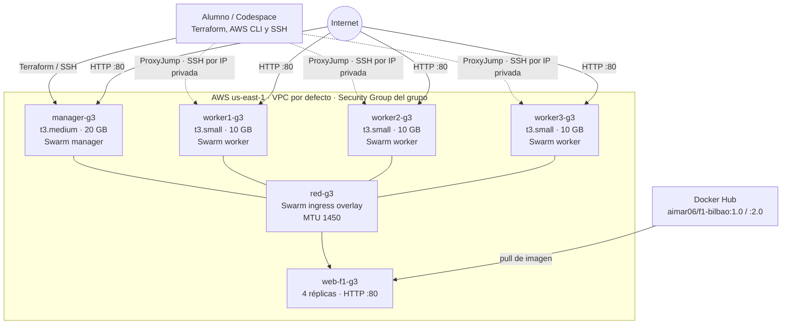

# Arquitectura del clúster

Los nombres e IPs son específicos del grupo 3. Las IPs públicas se consultan en
los outputs de Terraform y pueden cambiar al recrear las instancias; el tráfico
del clúster y los saltos SSH a workers usan IPs privadas.
